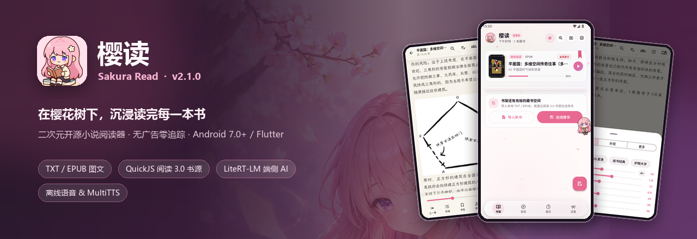
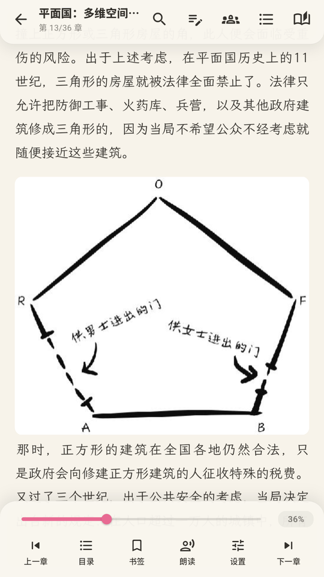
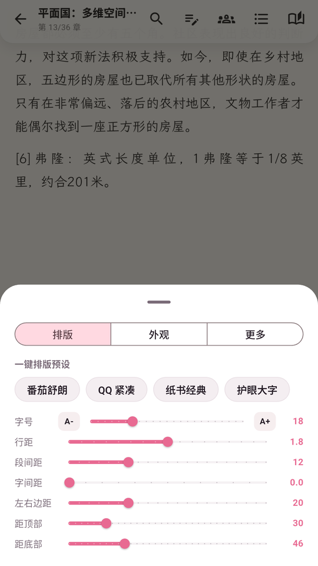
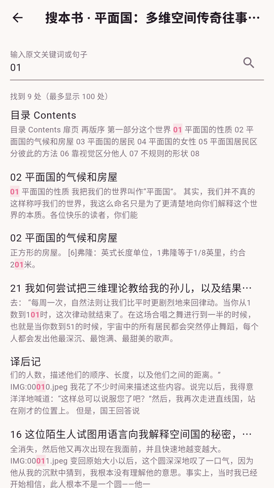
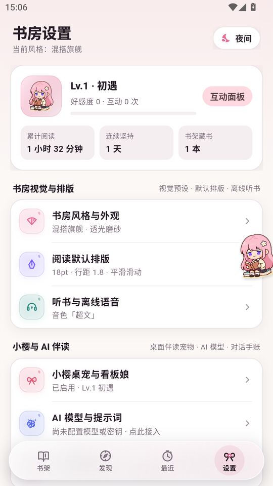
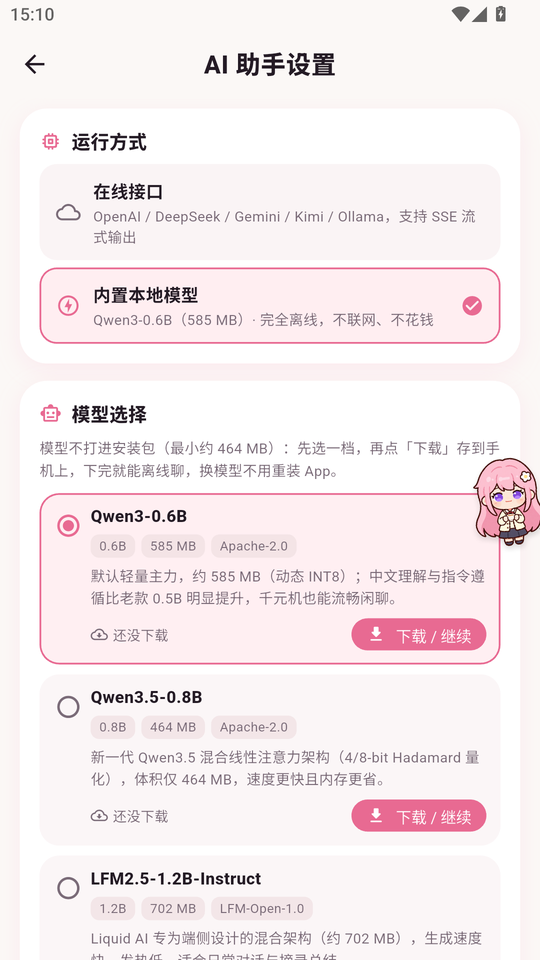
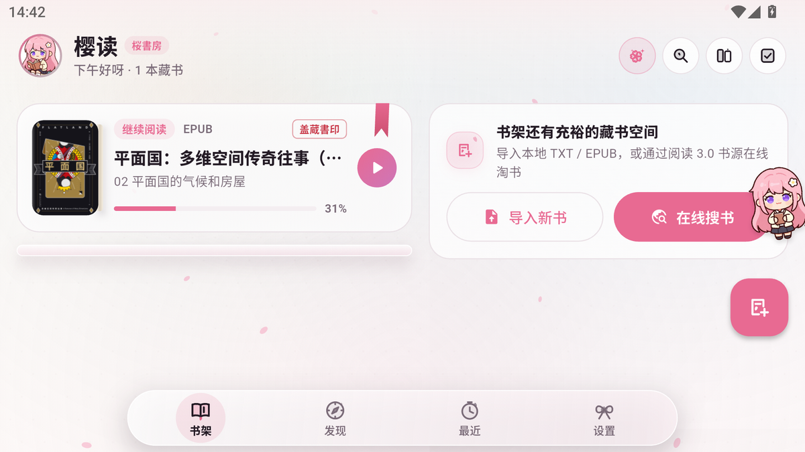

<div align="center">



<br/>

# 樱读 · Sakura Read

**在樱花树下，沉浸读完每一本书 — 轻量、流畅、无广告的二次元开源小说阅读器。**

支持本地 TXT / EPUB 图文精排、兼容「阅读 3.0」书源（内置 QuickJS 脚本引擎）、离线语音朗读、端侧开源小模型伴读与可关闭的桌面宠物小樱。

<p>
  <a href="../../releases/latest"></a>
  <a href="../../actions/workflows/ci.yml"></a>
  
  
  <a href="LICENSE"></a>
</p>

<p>
  <a href="#download">📥 快速下载</a> ·
  <a href="#screenshots">📸 界面预览</a> ·
  <a href="#features">✨ 核心特性</a> ·
  <a href="#local-ai">🤖 端侧 AI</a> ·
  <a href="#build">🔨 本地构建</a> ·
  <a href="#faq">❓ 常见问题</a>
</p>

</div>

---

<a id="screenshots"></a>

## 📸 界面预览

> 所有预览图均为 **v2.1.0** Release 包在 Android 模拟器中的真实运行截图。

<div align="center">

| 书架主页 · 桌宠伴读 | 日间精排 · EPUB 插图 | 阅读设置 · 一键预设 |
|:---:|:---:|:---:|
|  |  |  |
| **书内检索 · 高亮直达** | **书房设置 · 看板娘卡片** | **端侧模型 · 离线 AI** |
|  |  |  |

</div>

<details>
<summary><b>🖥️ 点击展开：横屏 / 平板双栏自适应布局预览（16:9 宽屏）</b></summary>
<br/>
<div align="center">
  
</div>
</details>

---

<a id="features"></a>

## ✨ 核心特性

### 📖 沉浸排版与本地阅读
- **全格式本地解析**：支持 TXT（自动探测 UTF-8 / UTF-16 / GBK 编码与智能切章）与 EPUB（完整提取 ``、`<svg><image xlink:href>` 与内联 `data:image/*;base64` 插图，点击图片可唤起高清缩放查看器）。
- **原版排版与精排引擎**：EPUB 原版视图支持外链资源拦截与「统一主题文字色」切换；分页/滚动模式均支持 **真实段间距**、**正文两端对齐**、字号/行距/字距/页边距微调。
- **一键排版预设 & 大字体包**：内置「**番茄舒朗 / QQ 紧凑 / 纸书经典 / 护眼大字**」4 套一键预设；支持导入最高 **60 MB** 的 `.ttf` / `.otf` / `.ttc` 自定义字体及本地阅读背景图。
- **多样翻页与秒开体验**：支持 GPU **3D 仿真翻页**（`paper_curl`）、平滑翻页与上下连续滚动（章节首尾无缝衔接）；Android 12+ 冷启动零白屏直出开屏动画并两级并行水合。
- **深读辅助工具**：支持阅读器内「**搜本书**」关键词高亮跳转、全书人物 **X-Ray** 图谱（别名归并 / 首次出场 / 常同场人物）、SQLite 批注划线与金句分享卡。

### 🌐 阅读 3.0 书源与书架管理
- **完整兼容 Legado 3.0 书源**：导入 JSON 即可并发搜书、聚合同名结果，内置 **QuickJS-NG** 引擎支持 `@js:` 规则与动态 URL，并内置书源体检过滤失效源。
- **流式换源与在线缓存**：换源界面实时流式增量展示可用源并支持随时停止，可勾选**保留原书封面与简介**；已缓存章节支持一键**导出为本地 TXT**。
- **灵活的书架整理**：支持网格 / 小图 / 列表 / 大封面四种视图，支持自定义分组、批量管理、编辑书籍信息（书名 / 作者 / 简介）以及**长按拖拽手动排序**。

### 🎧 离线听书与第三方引擎
- **开箱即用的离线 TTS**：随包内置 `sherpa-onnx` + VITS「超文」中文语音模型，无需联网或安装系统 TTS；可在「语音包」内按需下载 174 人「百变音色」（32 MB）或「小雅」（14 MB）。
- **顺畅的听书体验**：离线朗读后台自动**预合成下一段音频**消除段间卡顿；支持 **AI 分角色朗读**（旁白与对白自动区分音色/音调）、**定时停播**（倒计时 / 读完本章停止）及自动翻页同步。
- **完整第三方引擎兼容**：适配系统 TTS 与 MultiTTS 等第三方语音引擎，多包名全量扫描不漏检。

### 📦 数据安全、迁移与二次元陪伴
- **安全持久化与加密**：核心数据统一由 **SQLite** 原子持久化，API Key 采用 Android **Keystore AES-GCM** 硬件级加密存储。
- **多端备份与搬家**：支持本地 ZIP 一键备份恢复、**WebDAV**（坚果云 / Nextcloud / 群晖），并支持直接导入「阅读（Legado）」书架与进度备份。
- **可控的看板娘桌宠**：主角色「小樱」伴随阅读成长与换装差分，默认可交互陪伴，支持在设置中一键静音或完全关闭。

---

<a id="local-ai"></a>

## 🤖 端侧本地 AI 与云端伴读

AI 助手支持「**云端 API**」与「**手机端侧离线推理**」双模式，默认保护隐私，两种模式均可独立开关「附带当前阅读上下文」。

- **云端兼容接口**：兼容 OpenAI Chat Completions 协议，提供 **OpenAI / DeepSeek / Gemini / Kimi / Ollama** 一键预设与 SSE 流式输出。
- **端侧离线推理（Google LiteRT-LM 0.20）**：模型不进安装包，支持 ModelScope 国内镜像与 HuggingFace 镜像自动切换、断点续传下载：

| 模型名称 | 参数量 | 量化体积 | 开源协议 | 适用场景建议 |
| --- | :---: | :---: | :---: | --- |
| **Qwen3-0.6B**（默认轻量主力） | 0.6B | 585 MB | Apache-2.0 | 动态 INT8，低门槛高流畅度，千元机日常问答 |
| **Qwen3.5-0.8B** | 0.8B | 464 MB | Apache-2.0 | 混合线性注意力架构（4/8-bit Hadamard），体积最小速度更快 |
| **LFM2.5-1.2B-Instruct** | 1.2B | 702 MB | LFM-Open-1.0 | Liquid AI 端侧混合架构，低发热，适合摘录总结 |
| **Qwen3.5-2B** | 2B | 2.0 GB | Apache-2.0 | GatedDeltaNet 长上下文稳健旗舰，适合深度长文分析 |
| **Gemma 4 E2B** | E2B | 2.4 GB | Apache-2.0 | Google 2026 QAT 混合量化模型，综合推理与多语言表现强 |

---

<a id="download"></a>

## 📥 快速下载与安装升级

前往 [Releases 最新版](../../releases/latest) 下载对应架构的 APK（要求 **Android 7.0 / API 24** 及以上）：

| 安装包 | 体积 | `versionCode` | 适用设备 |
| --- | :---: | :---: | --- |
| [`SakuraRead-v2.1.0-arm64.apk`](../../releases/download/v2.1.0/SakuraRead-v2.1.0-arm64.apk) | 69.2 MB | `2073` | **绝大多数手机 / 平板首选** |
| [`SakuraRead-v2.1.0-x86_64.apk`](../../releases/download/v2.1.0/SakuraRead-v2.1.0-x86_64.apk) | 71.6 MB | `4073` | 桌面 Android 模拟器（MuMu / 雷电等） |

> **无缝覆盖升级**：与 `v1.2.x`、`v1.3.0`、`v2.0.0`、`v2.0.1` 使用同一发布签名证书，直接覆盖安装即可保留全部书架、进度、书源、批注与本地模型文件。

---

<a id="build"></a>

## 🔨 本地构建与代码结构

环境要求：**Flutter 3.47+**（Dart 3.13+，CI 固定 `3.47.9`）、Android SDK（API 24+）、JDK 17。

```bash
flutter pub get
dart format --output=none --set-exit-if-changed lib test
flutter analyze
flutter test test/epub_image_test.dart test/tts_service_test.dart test/reader_v2_engine_test.dart

# 构建手机真机 arm64 包（若需模拟器包请使用 --target-platform android-x64）
flutter build apk --release --split-per-abi --target-platform android-arm64
```

<details>
<summary><b>🗂️ 目录架构一览（<code>lib/src/</code> 与原生桥）</b></summary>

```text
lib/src/
├── core/       # SQLite 数据库引擎、安全存储与基础基础设施
├── data/       # 书架状态、TXT/EPUB 解析与插图提取、分页器、TTS 数据、本地 LiteRT-LM 目录
├── features/   # 模块化阅读器顶底栏、高清看图、批注、X-Ray 人物图谱与金句卡
├── platform/   # Android 原生桥接：TTS/离线语音播放、LiteRT-LM 推理、音量键翻页、文件权限
├── source/     # 阅读 3.0 书源引擎：规则拆分、Dio/Cookie 请求、并发搜索、QuickJS-NG 与 WebView
├── theme/      # 樱粉 / 薰衣草 / 多套阅读护眼主题与毛玻璃质感系统
├── ui/         # 书架、发现、最近、阅读器、AI 工作台、设置与看板娘弹窗页面
└── util/       # 通用编码、文本净化、高亮匹配与异步工具

android/app/src/main/kotlin/   # 原生语音播控、MultiTTS 扫描、Keystore 加密、LiteRT-LM 通道与首帧透明闪屏切换
```

</details>

---

<a id="faq"></a>

## ❓ 常见问题

<details>
<summary><b>某本在线书搜不到 / 换源一直转圈怎么办？</b></summary>

第三方书源站经常出现改版或域名失效。在搜索/换源时列表会实时流式展示结果，也可随时点「停止」先行选择已找到的源；建议定期在「设置 → 书源管理」运行**书源体检**清理失效规则。若希望保留当前好看的封面与简介，换源时请勾选「保留原书封面与简介」。
</details>

<details>
<summary><b>装了 MultiTTS 等第三方引擎为什么之前搜不到？或朗读没声音？</b></summary>

`v2.1.0` 已修复系统引擎扫描过滤问题（`listTtsEngines()`），在「设置 → 听书与离线语音」点击重新检测即可识别 MultiTTS 等引擎；若手机未装任何系统 TTS，切换到「内置离线语音（超文）」即可离线开箱即听。
</details>

<details>
<summary><b>AI 助手必须联网充钱吗？隐私安全吗？</b></summary>

不需要。你可以直接切换为「内置本地模型」，下载 `Qwen3.5-0.8B`（464 MB）或 `Qwen3-0.6B`（585 MB）即可全程断网在手机本地推理，阅读记录与提问不出设备；使用在线 API 时，密钥也仅通过系统 Keystore 加密保存于本地。
</details>

<details>
<summary><b>EPUB 书籍字体颜色花花绿绿或插图不显示怎么处理？</b></summary>

`v2.1.0` 已完整修复 SVG 包裹图片、Base64 内嵌图与特殊相对路径的提取；若部分 EPUB 自带内联颜色文字，可切换至原版排版视图并点击顶部「**统一主题文字色**」图标，一键覆盖为当前阅读主题配色。
</details>

---

## ⚖️ 说明与许可证

- **纯阅读工具声明**：本软件仅作为本地文件阅读器与用户自定义规则解析工具，不主动提供、分发或存储任何受版权保护的书籍内容；内置仅包含公版测试源（中文维基文库，CC BY-SA）及规则示例，请支持正版阅读。
- **独立实现**：兼容「阅读（Legado）3.0」JSON 规则格式与备份数据导入，全套核心逻辑均以 Dart 独立实现，未复用任何 GPL 代码。
- **开源许可**：源代码遵循 [MIT License](LICENSE)；内置字体「霞鹜文楷 Lite」遵循 SIL OFL-1.1；项目内含配套二次元立绘/UI 素材随仓库按 MIT 协议开放。

---

<div align="center">


<br/>

**如果樱读陪你静静多读完了几章书，欢迎点亮一颗 ⭐️ Star 支持项目！**

</div>
